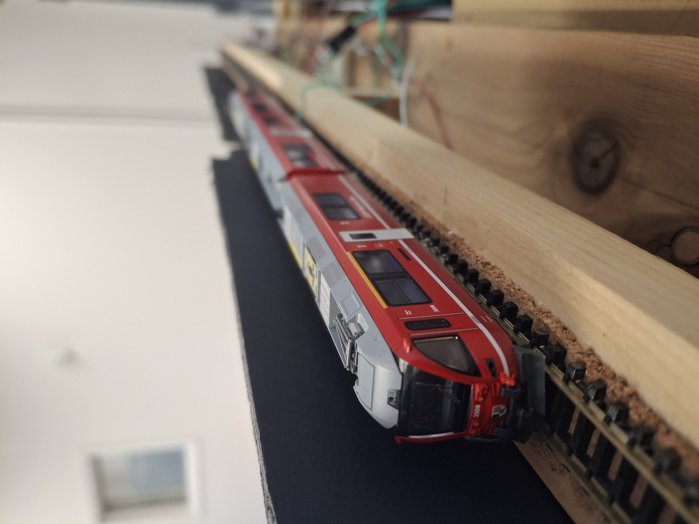
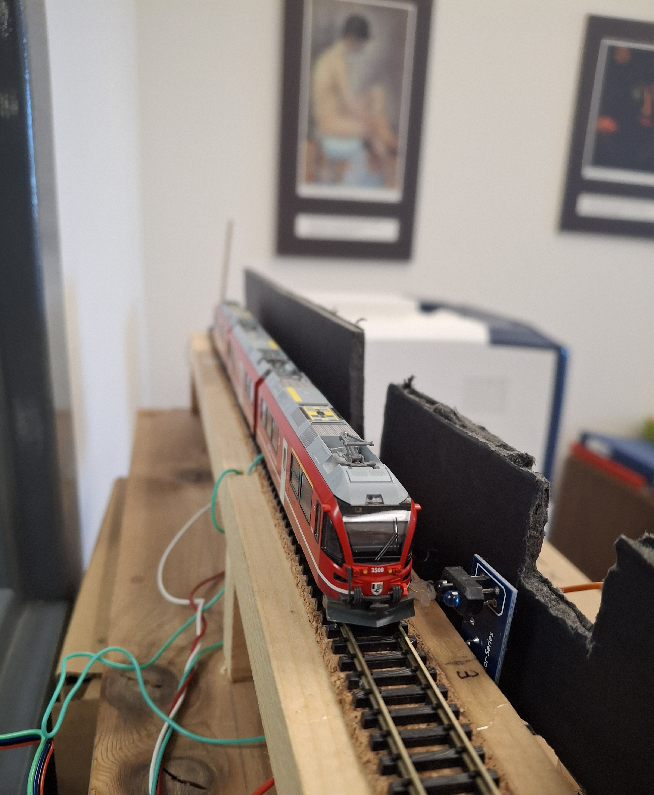
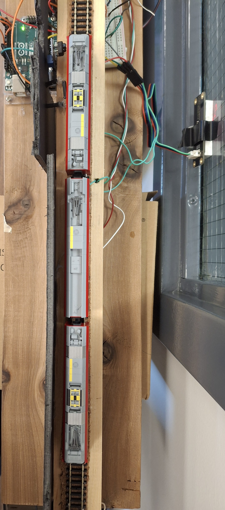

This is a Mechatronics and Computational Physics final project made by Noor Zatara, Bayezid Sikder and Samuel Kuperhouse.
It is a modification to a winter 2026 integrative project by 
Fatima Zahra Boucif, Nada Boukhari, Mariam Elgarh and Sarah Meghdir.

It is an N-Scale model of the Rhaetian Railway train made by Kato. 
The train is activated when the photoresistor is covered. 
Upon activation, the train completes a full round trip and increases the count on the LED display.

The train runs when one rail acts as the positive rail and the other as a negative rail. 
this allows the train to act as a bridge to allow the current to flow through it, 
which makes the motors start spinning.
reversing the signs allows the train to move in the opposite way.

The Railway is equipped with an Emergency brake system consisting of diodes that 
forces the current to go into one direction, 
which prohibits the current on last rail of the trains path from flowing.

[Find the code of the system here](final.ino)

images of the train:

Image of the sensor:

Image of the counter:

