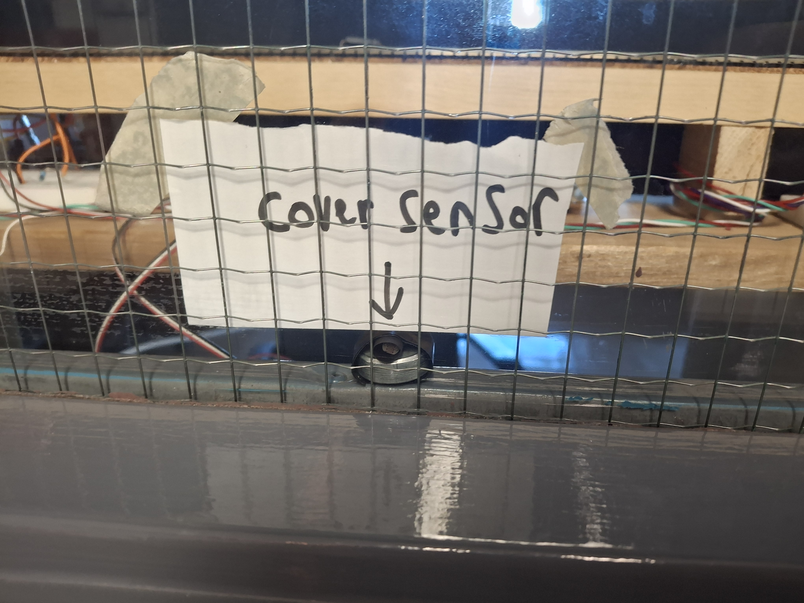
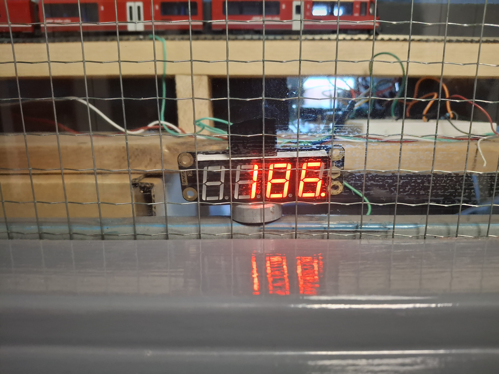
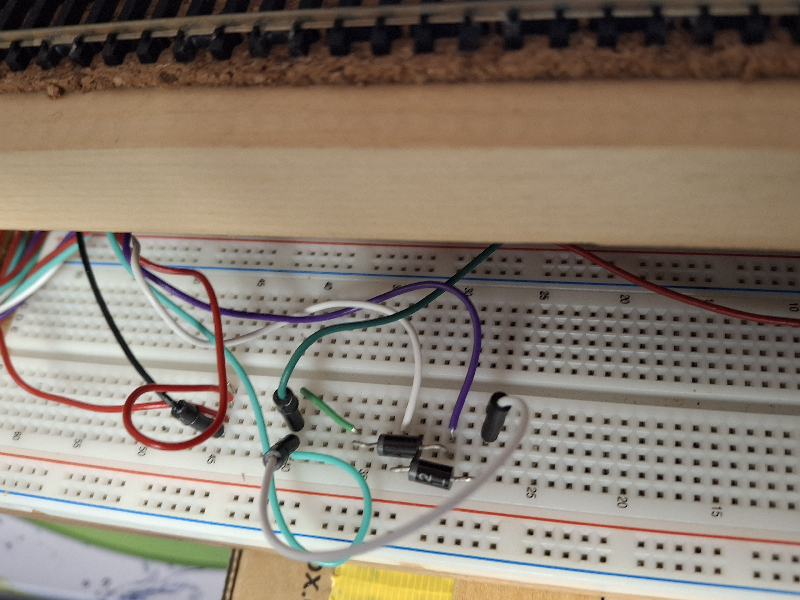
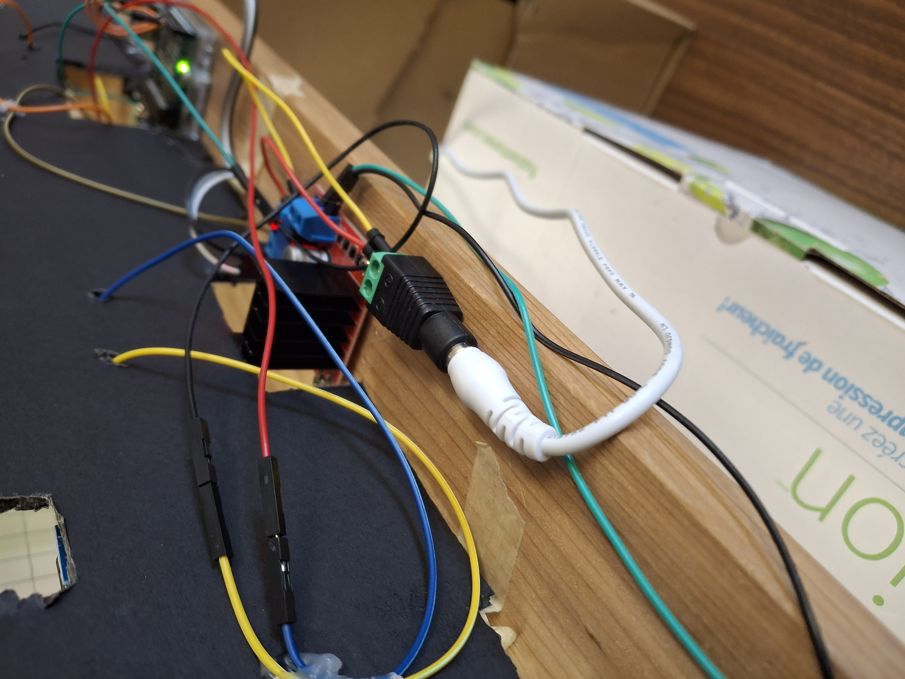
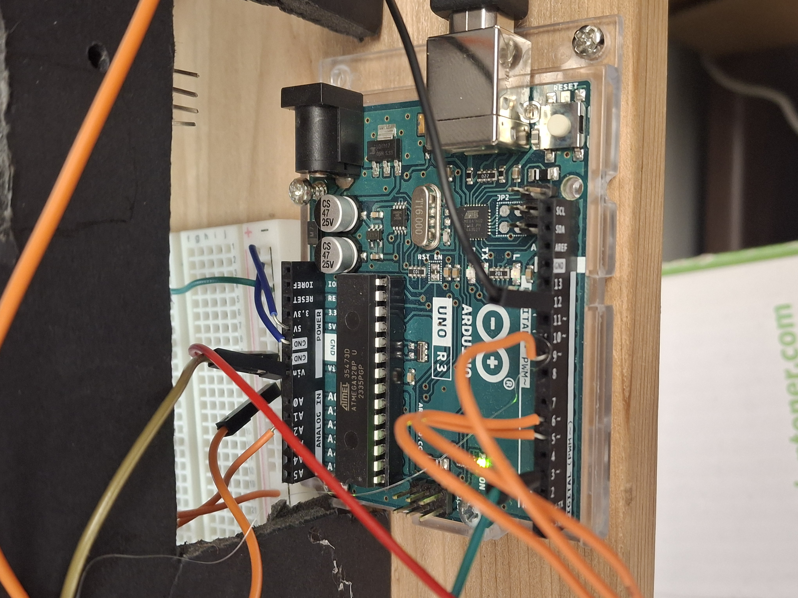
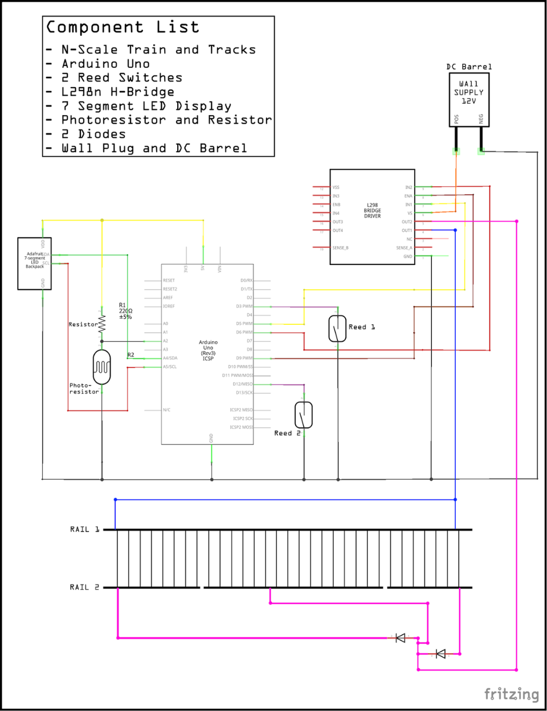

This is a Mechatronics and Computational Physics final project with teacher Stephan Bracher made by 
Noor Zatara, Bayezid Sikder and Samuel Kuperhouse.
It is a modification to a winter 2026 integrative project by 
Fatima Zahra Boucif, Nada Boukhari, Mariam Elgarh and Sarah Meghdir.

It is an N-Scale model of the Rhaetian Railway train made by Kato. 
The train is activated when the photoresistor is covered. 
Upon activation, the train completes a full round trip and increases the count on the LED display.

The train runs when one rail acts as the positive rail and the other as a negative rail. 
this allows the train to act as a bridge to allow the current to flow through it, 
which makes the motors start spinning.
reversing the signs allows the train to move in the opposite way.

The train has a magnet hidden inside. as it moves along the track, it hits 2 reed switches. 
Before hitting the first one, the train accelerates on its own. The first reed allows it to stay at
a constant speed. The second one allows it to decelerate to its first stop. When the train reverses,
the reeds switch roles to allow the train to have the same controlled journey back to the start.

The Railway is equipped with an Emergency brake system consisting of diodes that 
forces the current to go into one direction, 
which prohibits the current on last rail of the trains path from flowing.

[Find the video of the system here](https://youtu.be/nS-i9z6qutw?si=4ZewSrxfepYGK6gk)

[Find the code of the system here](final.ino)

images of the train:

Image of the sensor:

Image of the counter:

Image of the braking system:

Images of the electronics system:

Circuit Schematic:

Sources:

Boucif, F. Z., Boukhari, N., Elgarh, M., & Meghdir, S. (2026, May 18). Automated train with track-based control. Vanier College.
